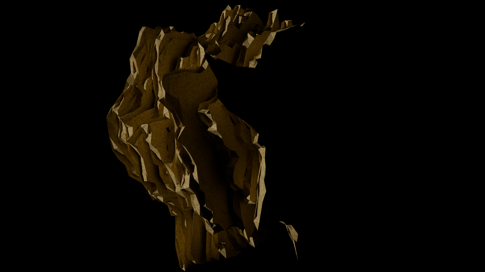
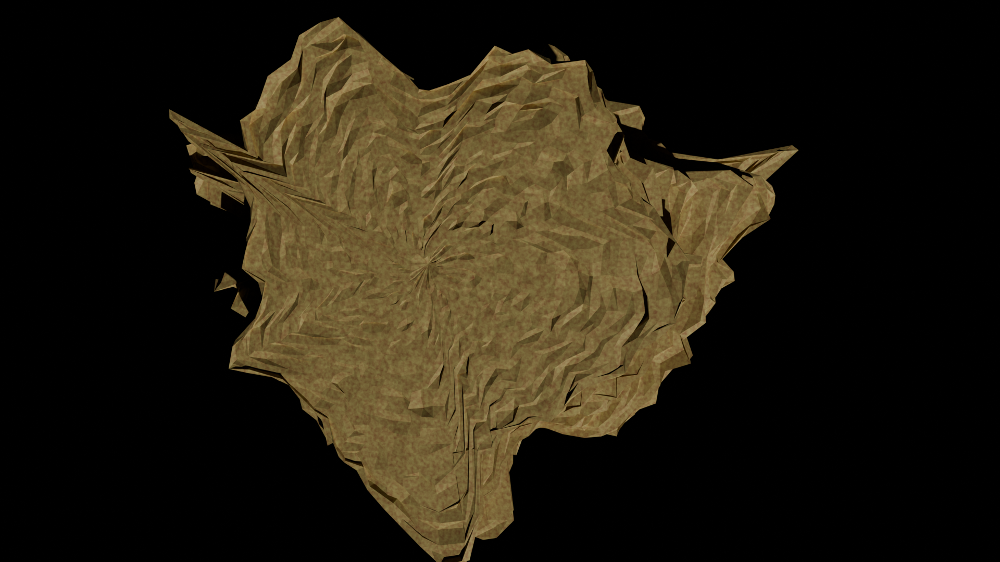

# Pancake rock generator
## Makes (or at least tries to make) sedimentary pancake rocks like this:


## Renders (made in blender) of the rocks it generates:
  


## Trying it out
Try it out (here)[https://duckdood.github.io/terra/pancakes/]

## Building locally (Tested on linux with GCC)
```
git clone https://github.com/DuckDood/pancake-rock-gen.git
cd pancake-rock-gen
make
```
This puts a program in build/ that will generate rocks and put it in an OBJ file named layer.obj
